 

 

## 👨‍💻 About Me

Fresh **Informatics** graduate from **Universitas Sriwijaya** with a GPA of 3.94. I build things at the intersection of **code and intelligence**: web applications, machine learning projects, and data-driven tools, backed by academic projects, Bangkit Academy, and an internship at PT PLN (Persero).

I enjoy turning ideas, research, and data into practical digital solutions that are **useful, reliable, and relevant to real-world needs**.

|  |  |
| :-- | :-- |
| 🔭 **Currently** | Web development & operations at Benang Merah Living Journal (freelance) |
| 🌱 **Focus areas** | Web Development · AI & Machine Learning · Data Analysis |
| 🎓 **Education** | Informatics Graduate, Universitas Sriwijaya (2022 – 2026) |
| 📫 **Reach me** | [mfaridsptra08@gmail.com](mailto:mfaridsptra08@gmail.com) |

 

## 🛠️ Tech Stack

  

 

## 🚀 Featured Projects

<table>
  <tr>
    <td width="50%" valign="top">
      <h3>🕋 HajiKu</h3>
      Umrah and Hajj agency platform: bookings, departures, and payments in one dashboard.  
      <code>Laravel</code> <code>MySQL</code> <code>Tailwind CSS</code>  
      <a href="https://hajiku.ifree.page">🔗 Live</a> · <a href="https://github.com/eferdee/umrohhajiweb">💻 Code</a>
    </td>
    <td width="50%" valign="top">
      <h3>🐾 Paw Clinic</h3>
      Vet clinic system for appointments, medical records, and operations.  
      <code>PHP</code> <code>JavaScript</code> <code>CSS</code>  
      <a href="https://pawclinic.ifree.page">🔗 Live</a> · <a href="https://github.com/eferdee/pawclinic">💻 Code</a>
    </td>
  </tr>
  <tr>
    <td width="50%" valign="top">
      <h3>💸 CatatKan</h3>
      Personal finance tracker: expenses, budgets, and savings goals.  
      <code>PHP</code> <code>MySQL</code> <code>JavaScript</code> <code>CSS</code>  
      <a href="https://catatkan.ifree.page">🔗 Live</a> · <a href="https://github.com/eferdee/catatkan">💻 Code</a>
    </td>
    <td width="50%" valign="top">
      <h3>🧠 MRI Enhancement for Alzheimer's Classification</h3>
      NAFNet MRI enhancement that improves Alzheimer's classification.  
      <code>PyTorch</code> <code>Python</code> <code>Computer Vision</code>  
      <a href="https://github.com/eferdee/enhancement-classification-alzheimer-s-mri">💻 Code</a>
    </td>
  </tr>
  <tr>
    <td width="50%" valign="top">
      <h3>📄 SummarizeePDF</h3>
      AI summarizer: upload a PDF, get a structured summary.  
      <code>FastAPI</code> <code>Python</code> <code>Gemini API</code>  
      <a href="https://github.com/eferdee/summarize-pdf">💻 Code</a>
    </td>
    <td width="50%" valign="top">
      <h3>📊 Review Intelligence</h3>
      AI-powered review summarization and sentiment analytics dashboard.  
      <code>AI Agent</code> <code>JavaScript</code> <code>HTML</code> <code>CSS</code>  
      <a href="https://github.com/eferdee/ecommerce-review-analyzer">💻 Code</a>
    </td>
  </tr>
  <tr>
    <td width="50%" valign="top">
      <h3>🚲 Bike Sharing</h3>
      Streamlit dashboard of bike-sharing usage by weather and weekday.  
      <code>Python</code> <code>Streamlit</code> <code>Data Analysis</code>  
      <a href="https://bike-sharing-eferdee.streamlit.app">🔗 Live</a> · <a href="https://github.com/eferdee/analisis-data-1">💻 Code</a>
    </td>
    <td width="50%" valign="top">
      <h3>📚 BimBook</h3>
      Advising booking: lecturers open slots, students book and track status.  
      <code>PHP</code> <code>MySQL</code> <code>CSS</code> <code>JavaScript</code>  
      <a href="https://bimbook.ifree.page">🔗 Live</a> · <a href="https://github.com/eferdee/bimbook">💻 Code</a>
    </td>
  </tr>
  <tr>
    <td width="50%" valign="top">
      <h3>🎒 BelajarKuy</h3>
      Student productivity app: tasks, planner, calendar, and notes.  
      <code>Node.js</code> <code>Express</code> <code>SQLite</code> <code>JWT</code>  
      <a href="https://github.com/eferdee/belajarkuy">💻 Code</a>
    </td>
    <td width="50%" valign="top">
      <h3>📸 Benang Merah Booth</h3>
      Virtual photobooth with custom frames, live capture, and booking.  
      <code>PHP</code> <code>MySQL</code> <code>JavaScript</code>  
      <a href="https://benangmerahbooth.ifree.page">🔗 Live</a>
    </td>
  </tr>
</table>

**More projects (QR Keun, Split Keun, a Unity game, and others) →** [**m-farid-saputra.vercel.app/#projects**](https://m-farid-saputra.vercel.app/#projects)

 

## 💼 Experience

| Period | Role | Where |
| :-- | :-- | :-- |
| **Jul 2026 – Present** | 📸 Project Team Member, Web Development & Operations | Benang Merah Living Journal · Freelance |
| **Sep – Dec 2024** | 🤖 Machine Learning Path (Kampus Merdeka MSIB) | Bangkit Academy |
| **Jul – Aug 2024** | ⚡ Intern: data management system with Google Apps Script & Google Sheets (full CRUD) | PT PLN (Persero) UP3 Palembang |
| **Aug 2022 – Apr 2026** | 🎓 B.Sc. Informatics | Universitas Sriwijaya |

 

## 🏅 Highlighted Credentials

- 🤖 **Bangkit Academy Machine Learning**: Dicoding Indonesia (2024)
- 🧪 **DeepLearning.AI TensorFlow Developer**: DeepLearning.AI (2024)
- 🎓 **Machine Learning**: DeepLearning.AI × Stanford Online (2024)
- 📊 **Data: AI Agent for Data Analysis**: IBM SkillsBuild × Hacktiv8 Indonesia (2026)
- 🐍 **Learn Data Analysis with Python**: Dicoding Indonesia
- 🌐 **Web Designing Basics**: Simplilearn SkillUp (2026)

 

## 📈 GitHub Stats

 

## 📫 Let's Connect

I'm open to new opportunities in web development, machine learning, and data analysis. If you have a project, an idea, or just want to say hi, my inbox is open.

 

